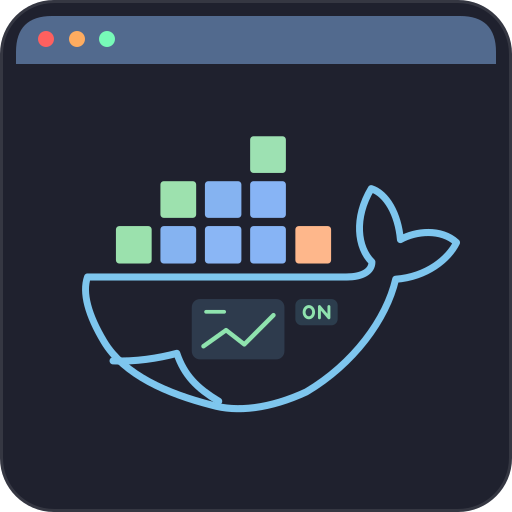
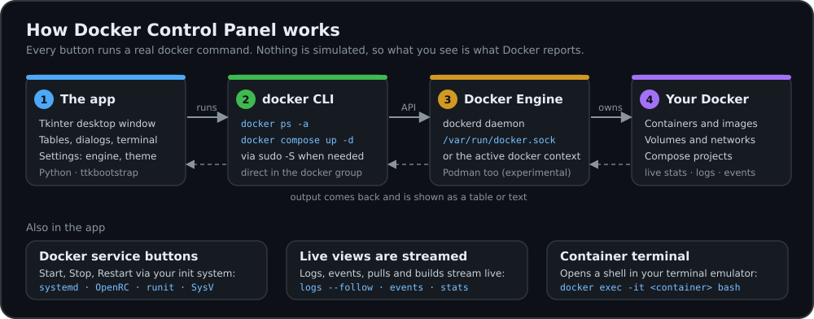

<p align="center">
  
</p>

<h1 align="center">Docker Control Panel</h1>

<p align="center">
  A graphical Docker manager for <b>Linux</b> — control containers, images, volumes, networks, Compose projects, and live stats without typing docker commands.
</p>

## Why this exists

Docker on Linux is a daemon and a command line. That is powerful, but a lot to remember when all you want is to see what is running, read a log, free some disk space or open a shell in a container. **Docker Desktop** solves that, but on Linux it runs its own virtual machine with its own separate images and containers, needs virtualization support, and has licence terms that apply to larger companies.

**Docker Control Panel** was built for people who run the **normal Docker Engine on their own Linux machine** and want a graphical front end for *that* engine: native, small, free of accounts and telemetry, and honest about what it does, because every button shows the real `docker` command behind it.

### Advantages

- **It manages your real engine.** It talks to the Docker (or Podman) that is already on the host, so you see the same containers and images as `docker ps` does. No second engine, no VM.
- **Light and native.** A small Python / Tkinter program: no virtualization requirement, no background services of its own, starts in seconds.
- **Works on any Linux.** One `./install.sh` for Debian / Ubuntu, Fedora / RHEL family, Arch, openSUSE, Alpine and Void, on Python 3.8 or newer, with systemd, OpenRC, runit or SysV. Tested on real images of each (see [Installation](#installation)).
- **Nothing hidden.** The Commands tab lists every command the app runs, and the home page shows which CLI, engine and socket are in use (see below). It teaches the CLI instead of replacing it.
- **Built for housekeeping.** Bulk actions (start / stop / delete all, prune, **Clean All**), tables you can search, sort and filter by creation date, rows coloured when a container is unhealthy or restarting, and a Compose list that also keeps stopped projects.
- **Private by design.** No account, no analytics, no telemetry. Your data stays on your computer ([Privacy Policy](PRIVACY.md)).
- **Nothing to subscribe to.** The app has no per-company subscription rules of its own. (Docker Engine and the other tools it uses keep their own licences.)

### Docker Control Panel and Docker Desktop

They overlap, and they are not rivals: use whichever suits the job.

| | Docker Control Panel | Docker Desktop (Linux) |
|---|---|---|
| Engine it manages | the Docker / Podman already on your machine | its own engine inside a VM, separate from a host install |
| Needs | Python, Tk and Docker; no virtualization | KVM virtualization and a supported distribution package |
| Footprint | one small Python app | a VM plus the desktop application |
| Account / telemetry | none | account sign-in is offered; see Docker's own policy |
| Licence terms | none attached to the app itself | free for personal use, education and small business; a paid subscription for larger companies |
| Shows the command behind each action | yes, always | not as a rule |
| Container shell | opens in your own terminal emulator (17 supported) | built-in terminal |
| Where it is better | your own engine, housekeeping, any distro, low overhead | Kubernetes, extensions, Docker Scout dashboards, built-in image and build views |

**Choose Docker Desktop** if you want its extras (Kubernetes, extensions, Docker Scout dashboards) or the same tool on Windows and macOS. **Choose Docker Control Panel** if you run Docker Engine directly on Linux and want a fast, private, no-nonsense control panel for it. You can run both: they manage different engines.

## How it works

<p align="center">
  
</p>

Every button builds a real `docker` command, runs it through `sudo` (or directly when you are in the `docker` group), and shows what Docker answers as a table or text. Nothing is simulated.

The **Docker home page** shows the same path live, for *this* machine: which CLI is used (path and version), which engine and socket it talks to, how access works (sudo or direct), which init system starts and stops the daemon, and how many containers and images exist. It refreshes when the page is shown, after Start / Stop / Restart, and with its **↻ Refresh** button. Hover any home-page button (Start, Stop, Restart, Clean All, each category card) for a tooltip explaining what it does.

## What it covers

About 100 docker commands, one sidebar category each:

| Category | What you can do |
|---|---|
| 🐳 **Docker** | Home page with a live "How it works" card, start / stop / restart the Docker service (systemd, OpenRC, runit or SysV), bulk-clean all resources |
| 📦 **Containers** | View, start, stop, restart, pause, rename, inspect, commit, delete, file browser |
| 🖼 **Images** | Pull, push, search Docker Hub, build, load, save, tag, inspect, run, prune, delete |
| 💾 **Volumes** | View, create, inspect, prune, delete used/unused/all |
| 🕸 **Networks** | View, create, inspect, connect, disconnect, prune |
| 🧩 **Compose** | List projects, bring up from file, down, restart, logs, config |
| 📊 **Stats** | Live container resource usage with CPU/memory trends, detailed disk-usage breakdown |
| ⚙ **System** | Engine info, contexts, live events, builders, build-cache prune |
| 💻 **Terminal** | Interactive shell inside any running container, opened in your terminal emulator (17 supported: tilix, gnome-terminal, ptyxis, konsole, kitty, alacritty, xterm, …) |
| 📄 **Logs** | View and follow container logs with optional timestamps |

Other highlights:
- **Search** — filter any table by typing
- **Right-click** — copy cell values or entire rows
- **Themes** — six persisted ttkbootstrap themes (Darkly by default, Superhero, Solar, Vapor, Cosmo, Flatly)
- **Password manager** — sudo password kept in the desktop keyring (`secret-tool`) when available, else in `~/.docker-gui/config.json` (0600); not asked at all if your user is in the `docker` group
- **Registry login**, container Details / Processes / Changes / Export, image Scan / Import / Dangling, followable Compose logs, desktop notifications and a Settings dialog
- **Sidebar status** — Docker Running ✅ / Stopped ❌ always visible
- **Active category indicator** — theme-coloured accent strip on the active sidebar button
- **Pull / Build status** — close the streaming window and re-open it later via the status button

## Requirements

- Linux (x86-64 or ARM) with Python **3.8 or newer** and Tk 8.6, which the installer sets up for you
- sudo (or run as root) so the installer can install packages, and so the app can run `docker` unless you are in the `docker` group

Everything else — python3 + tkinter + venv, Docker, a terminal emulator, and the Python packages in `requirements.txt` (`ttkbootstrap`, `pillow`) — is installed for you.

## Installation

One command, no questions asked. Run it again any time: it only does what is missing, and rebuilds a broken `.venv`.

```bash
./install.sh
```

It detects your distribution and installs the system packages through its package manager (asking for your sudo password once), builds a private `.venv`, then creates the Applications-menu entry (with the app icon, installed into your `hicolor` icon theme) and a `docker-gui` command in `~/.local/bin`.

| Family | Distributions | Package manager | Docker comes from |
|---|---|---|---|
| Debian | Debian 12+, Ubuntu 20.04+, Mint, Pop!_OS, Raspberry Pi OS, … | `apt` | `docker.io` |
| Red Hat | Fedora, RHEL / Rocky / Alma / CentOS Stream 8+, Oracle, Amazon Linux 2023 | `dnf` / `yum` | Fedora: `moby-engine`; Amazon: `docker`; RHEL clones: Docker's official repo |
| Arch | Arch, Manjaro, EndeavourOS | `pacman` | `docker` |
| SUSE | openSUSE Leap / Tumbleweed, SLE | `zypper` | `docker` |
| Alpine | Alpine | `apk` | `docker` (OpenRC) |
| Void | Void Linux | `xbps` | `docker` (runit) |

- **Old system Python** (RHEL 8, openSUSE Leap 15 …): a newer `python3.x` is installed next to it and used for the app's `.venv`.
- **Docker service**: enabled and started with systemd, OpenRC, runit or SysV, whichever the system uses.
- **NixOS** and **immutable systems** (Silverblue, SteamOS …) cannot be installed into in place; the installer says what to do instead.

Tested on real images of Ubuntu 20.04 – 24.04, Debian 12, Fedora, Rocky / Alma 8 and 9, Amazon Linux 2023, Arch, openSUSE Leap and Tumbleweed, Alpine and Void (`tests/distro_smoke.sh`, also run in CI).

## Running

```bash
docker-gui                  # after installing (~/.local/bin must be on PATH)
./docker-gui                # straight from the project folder
```

Or use the Applications menu entry.

Docker status and the Start / Stop / Restart buttons follow the init system; without any (WSL1, containers) only the status is shown, from `docker info`. Podman support is experimental.

## Project Layout

```
docker-ui-modular/
├── docker_gui_modular.py        # Entry point — DockerGUI class
├── docker-gui                   # Launcher (plain POSIX sh)
├── install.sh / uninstall.sh    # One-command installer / uninstaller
├── requirements.txt             # Python dependencies installed into .venv
├── PRIVACY.md / TERMS.md        # Privacy Policy / Terms of Use (generated from src/help/legal.py)
├── assets/
│   ├── docker-icon.svg          # App icon (vector; installed menu icon, README)
│   ├── docker-icon.png          # Same icon at 256 px (window icon, home-page hero)
│   └── workflow.svg             # "How it works" diagram (README)
├── tests/
│   ├── test_buttons.py          # Unit tests: command constants, GUI wiring (no daemon needed)
│   ├── test_new_features.py     # Unit tests: settings, keyring, engine, events, registry, System
│   ├── test_linux_compat.py     # Unit tests: init systems, service buttons, status, terminals, old Pythons
│   ├── test_home_page.py        # Unit tests: "How it works" card, home-page tooltips, creator details, images
│   ├── test_legal.py            # Unit tests: Privacy / Terms text, first-run acceptance, reader, home links
│   └── distro_smoke.sh          # Runs the installer on real distro images (docker needed; also used by CI)
└── src/
    ├── config/
    │   ├── config_manager.py    # Password / config I/O
    │   ├── config_menu.py       # Sidebar menu + all button wiring
    │   ├── config_themes.py     # Theme colour palettes
    │   └── config_tooltips.py   # Tooltip text for all buttons
    ├── docker/
    │   ├── actions.py           # Docker service actions (start/stop/restart)
    │   ├── commands.py          # All docker CLI command strings (single source)
    │   └── operations.py        # subprocess execution layer
    ├── containers/
    │   ├── actions.py           # Bulk container actions (start/stop/restart/delete all)
    │   ├── details.py           # Readable container details (docker inspect)
    │   ├── dialogs.py           # File browser, terminal, shared logs viewer
    │   └── tables.py            # Container Treeview population
    ├── images/
    │   ├── actions.py           # Bulk image actions (prune, delete all)
    │   ├── dialogs.py           # Pull, push, registry login, search Hub, build, load, import, scan
    │   └── tables.py            # Image Treeview population
    ├── volumes/
    │   ├── actions.py           # Bulk volume actions (prune, delete used/all)
    │   ├── dialogs.py           # Create volume dialog
    │   └── tables.py            # Volume Treeview population
    ├── networks/
    │   ├── actions.py           # Bulk network actions (prune)
    │   ├── dialogs.py           # Create network dialog
    │   └── tables.py            # Network Treeview population
    ├── compose/
    │   ├── dialogs.py           # Compose up-from-file dialog
    │   └── tables.py            # Compose project Treeview population
    ├── stats/
    │   ├── dialogs.py           # Disk usage detail view
    │   └── tables.py            # Stats (live, trends) and disk storage Treeview population
    ├── system/
    │   ├── actions.py           # Info, builders, prune build cache
    │   ├── dialogs.py           # Live events window
    │   └── tables.py            # Docker contexts
    ├── shared/
    │   ├── context_menus.py     # Right-click menus for table and text views
    │   ├── helpers.py           # Shared formatting / argument-building utilities
    │   ├── item_actions.py      # Per-row action buttons (create_selected_item_actions)
    │   └── stream.py            # Session-tracking for streaming commands (build/pull)
    ├── ui/
    │   ├── ui_components.py     # Reusable dialogs (password prompt, install prompt, Tooltip)
    │   ├── ui_display.py        # DisplayManager — owns the output area
    │   ├── settings_dialog.py   # Settings dialog
    │   ├── terminal_panel.py    # Embedded terminal panel
    │   └── keyboard_navigation.py
    ├── ui/
    │   ├── landing_page.py      # Docker home page: hero, service buttons (tooltips), live card, category cards, legal links
    │   ├── workflow_view.py     # "How it works" card (canvas diagram of app → CLI → engine → resources)
    │   └── legal_view.py        # Privacy / Terms reader dialog and the first-run agreement
    ├── help/
    │   ├── help_commands.py     # Commands tab text
    │   ├── help_creator.py      # Creator info (name, role, portfolio, GitHub, email)
    │   ├── legal.py             # Privacy Policy + Terms text (source of the app pages and the .md files)
    │   └── help_info.py         # Help tab text
    └── utils/
        ├── utils.py             # Docker detection, run_cmd, async_run, notifications
        ├── platform_utils.py    # Init system detection + service commands, package manager, environment
        ├── terminals.py         # Terminal emulators: detection, launching, install hint
        └── threads.py           # Async operation helpers
```

## Adding a New Action Button

1. Add the command string to `src/docker/commands.py`.
2. Implement the function in the appropriate feature module (e.g. `src/containers/actions.py`).
3. Register the button in `src/config/config_menu.py` → `get_menu_structure()`.
4. Add a tooltip entry to `src/config/config_tooltips.py`.

## Adding a New Table View

Follow the pattern in the relevant `tables.py` module:

```python
def show_my_resource(show_table_callback, show_loading_callback):
    if not check_docker_running(): return
    show_table_command(
        MY_COMMAND,
        ["Col1", "Col2"],
        sudo=True, sudo_password=get_sudo_password(),
        table_callback=show_table_callback,
        loading_callback=show_loading_callback,
        table_type='my_resource',
        table_title="My Resources"
    )
```

## Security

- Sudo password stored at `~/.docker-gui/config.json` with `chmod 0600`.
- All docker commands built from constants — user input is never interpolated into shell strings.
- Password is never logged or printed.
- All `run_cmd` calls pass `sudo=True, sudo_password=get_sudo_password()` so every docker command runs under sudo consistently.
- Terminal launch uses a SUDO_ASKPASS helper script (chmod 0700, cleaned up after use) so sudo does not consume the interactive shell's stdin.

## Tests

```bash
python3 -m unittest discover -s tests -t . -v
```

Unit tests cover the command constants, GUI action wiring and the newer features (settings, keyring storage, engine swap, events, registry, System). They use `unittest.mock` — no real Docker daemon required. GitHub Actions runs them (and `ruff check`) on Python 3.8 – 3.13, and runs the installer on 14 distribution images, on every push.

## Privacy and Terms

- [**Privacy Policy**](PRIVACY.md): what is stored on your computer (a small settings file; the sudo password only if you choose to save it, in the desktop keyring when available) and the few times the network is used (Docker talking to registries, and a Docker Hub size lookup in the search dialog). No telemetry, no accounts.
- [**Terms of Use**](TERMS.md): what the app is, that its destructive actions are your responsibility, no warranty, and that it is independent of Docker, Inc.

Both are available **inside the app** (Docker home page → *Privacy Policy* / *Terms of Use*) and are shown on **first start**, where you accept or decline before the app runs; they are shown again if they ever change. The installer points to them too. For unattended setups (kiosks, automated tests), set `DOCKER_GUI_ACCEPT_TERMS=yes` to record acceptance without the dialog; setting it means you accept the documents.

## Author

**Majid Ali** — Full Stack Developer

- Portfolio: [majidev.netlify.app](https://majidev.netlify.app)
- GitHub: [Majid-Ali-Watto](https://github.com/Majid-Ali-Watto)
- Email: [majidaliqau@gmail.com](mailto:majidaliqau@gmail.com)

The same details are in the app's **Creator** tab, with Open and Copy buttons.

## Uninstall

```bash
./uninstall.sh          # entry, command, icon and .venv
rm -rf ~/.docker-gui/   # also remove saved settings (and the saved password, if the keyring was not used)
```
